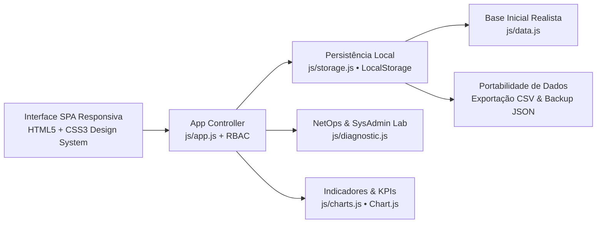

# Mini-ITSM — IT Service Desk & Technical Support Portal

[](https://pages.github.com/)
[](https://github.com/)
[](https://github.com/)

Plataforma web corporativa de **Gerenciamento de Serviços de TI (ITSM)** projetada para simular operações reais de **Service Desk, NOC (Network Operations Center), Infraestrutura de TI e Suporte Técnico N1/N2**, inspirada em soluções enterprise como *ServiceNow*, *Jira Service Management* e *Freshservice*.

---

## Problema Real Resolvido

Em operações reais de TI e provedores de conectividade, o escalonamento desestruturado entre suporte N1 e equipes especialistas (Redes, Infraestrutura, Cloud e Active Directory) gera gargalos de SLA, retrabalho e falta de visibilidade sobre ativos críticos.

O **Mini-ITSM** resolve esse fluxo ponta a ponta diretamente no navegador, sem depender de servidores externos ou bancos de dados pagos:

1. **Triagem Técnica Obrigatória (N1 → N2):** Antes de escalonar um incidente, o analista valida um checklist técnico estruturado (ICMP/Latência, Status Físico/Sinal Óptico, DNS/Roteamento e Coleta de Logs).
2. **Controle de SLA e Priorização ITIL:** Cálculo automático de prazos por criticidade (`P1 - 2h`, `P2 - 4h`, `P3 - 12h`, `P4 - 24h`) com alertas preventivos e acompanhamento de MTTR.
3. **CMDB Integrado aos Incidentes:** Vínculo direto entre chamados e ativos de infraestrutura (Servidores Windows/Linux, OLTs GPON, Roteadores BGP, Switches Core e instâncias AWS EC2).
4. **NetOps & SysAdmin Diagnostic Lab:** Ferramentas de engenharia embutidas no portal (Calculadora IPv4/CIDR, Orçamento Óptico PON/FTTH, Analisador de Logs MTR/Traceroute e Gerador de Scripts PowerShell/Bash).

---

## Arquitetura da Aplicação



---

## Funcionalidades Implementadas

* **Dashboard Operacional & KPIs:** Indicadores em tempo real de chamados abertos, conformidade de SLA (%), MTTR médio, incidentes críticos P1 e 4 gráficos interativos via Chart.js.
* **Gestão de Chamados (Lista & Kanban):** Criação de incidentes, filtros multicritério (status, prioridade, fila, busca), visualização em tabela corporativa ou quadro Kanban, histórico de notas internas/públicas e checklist técnico de triagem.
* **Inventário de Ativos & CMDB:** Cadastro, edição e monitoramento de status (`Online`, `Alerta`, `Offline`) com abertura de incidentes vinculados em 1 clique.
* **Triagem & NetOps Lab:**
  * Calculadora de Sub-redes IPv4 / CIDR.
  * Simulador de Orçamento Óptico PON / FTTH (dBm).
  * Analisador automático de logs `WinMTR` / `mtr` com geração de laudo N2.
  * Gerador de scripts PowerShell (Active Directory) e Bash (Hardening Linux SSH/UFW).
* **Base de Conhecimento (Runbooks ITIL):** Procedimentos Operacionais Padrão (POPs) pesquisáveis com comandos prontos para cópia.
* **Simulação de Perfis (RBAC) & Relatórios:** Alternância entre *Gestor de TI*, *Analista N2* e *Suporte N1*, além de exportação `.CSV` (Excel), backup/restauração `.JSON` e reset do ambiente demo.

---

## Estrutura de Pastas

```text
mini-itsm-service-desk/
├── index.html          # Estrutura SPA completa e modais interativos
├── .nojekyll           # Compatibilidade nativa com GitHub Pages
├── README.md           # Documentação técnica do projeto
├── LICENSE             # Licença MIT
├── css/
│   └── styles.css      # Design System corporativo (Navy, Tech Blue, Neutral Gray)
├── js/
│   ├── data.js         # Dados iniciais realistas (Chamados, CMDB, Runbooks, Logs)
│   ├── storage.js      # Persistência LocalStorage, CRUD, CSV e Backup JSON
│   ├── diagnostic.js   # Motores de cálculo CIDR, FTTH, MTR e Scripts SysAdmin
│   ├── charts.js       # Gráficos analíticos com Chart.js
│   └── app.js          # Roteamento, regras de negócio, RBAC, busca global e eventos
└── docs/
    └── ARQUITETURA.md  # Detalhamento técnico do modelo de dados e fluxos ITIL
```

---

## Como Publicar no GitHub Pages (Zero Configuração)

1. Crie um novo repositório público no GitHub (ex.: `mini-itsm-service-desk`).
2. Faça o upload de todos os arquivos desta pasta mantendo a estrutura original (`index.html` na raiz).
3. Acesse **Settings → Pages** no repositório.
4. Em **Build and deployment → Source**, selecione **Deploy from a branch**, escolha a branch `main` e a pasta `/ (root)` e clique em **Save**.
5. Em poucos segundos, o sistema estará no ar pronto para ser compartilhado no seu LinkedIn e portfólio.

---

## Autor

Desenvolvido por **Glauco Guedes** — Tecnologia da Informação, Infraestrutura, Redes & Desenvolvimento de Software.
